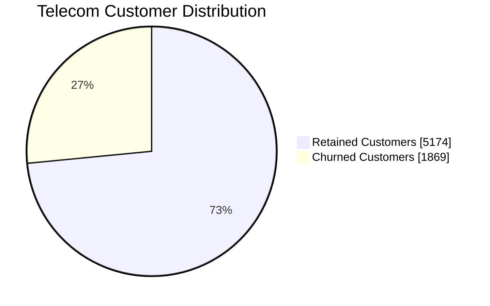
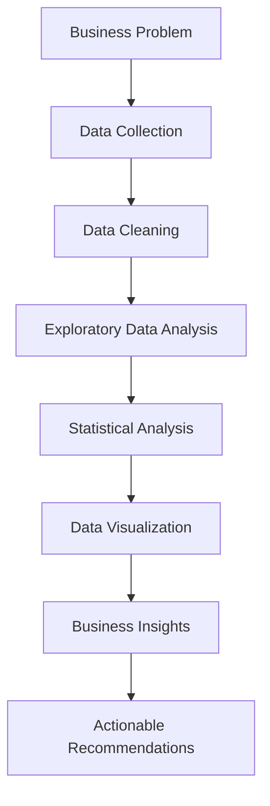

# SOMMAY DEWAT
### DATA ANALYST | BUSINESS INTELLIGENCE | PYTHON & SQL

**Transforming Data into Insights | Driving Data-Informed Decisions**

📍 India &nbsp; | &nbsp; 💼 Open to Data Analyst Opportunities

[LinkedIn](https://www.linkedin.com/in/sommay-dewat/) · [GitHub](https://github.com/SommayDewat)

---

## 👨‍💻 About Me

I'm a **BBA graduate passionate about Data Analytics and Business Intelligence**, with hands-on experience in Python, SQL, data visualization, statistical analysis, and Machine Learning.

I enjoy exploring datasets, identifying meaningful patterns, understanding business problems, and transforming raw information into actionable insights.

**My analytical interests:**
- Data Analysis & Exploratory Data Analysis (EDA)
- SQL & Relational Database Management
- Business Intelligence & Reporting
- Data Visualization & Dashboard Development
- Statistical Analysis & Hypothesis Testing
- Customer & Business Analytics
- Predictive Analytics & Machine Learning

---

## 🛠️ Technical Skills

| Category | Skills & Technologies |
|:---|:---|
| Programming | Python, SQL |
| Data Analysis | Pandas, NumPy, Data Cleaning, EDA |
| Visualization | Power BI, Excel, Matplotlib, Seaborn, Plotly |
| Database | MySQL, SQLite, MySQL Workbench |
| Statistics | Descriptive Statistics, Hypothesis Testing |
| Machine Learning | Scikit-learn, Random Forest, Model Evaluation |
| AI & NLP | TensorFlow, NLP, Deep Learning, Computer Vision |
| Development Tools | Git, GitHub, Jupyter, VS Code, Streamlit |

---

## 📊 Data Analytics Snapshot

A snapshot of the datasets and analytical work I've handled.

| Analytical Area | Data Processed |
|:---|---:|
| Retail Transaction Analytics | 541K+ transactions |
| Telecom Customer Analytics | 7,043 records |
| Customer Segmentation | 4,338 customers |
| Customer Review Analytics | 5,000+ reviews |

---

## 📈 Analytical Insights

### Customer Retention Analysis

An example of business insights generated through customer churn analysis.

| KPI | Result |
|:---|---:|
| Total Customers | 7,043 |
| Retained Customers | 5,174 |
| Churned Customers | 1,869 |
| Retention Rate | 73.46% |
| Churn Rate | 26.54% |
| Average Monthly Charges | 64.76 |

### My Data Analytics Workflow

---

## 🎯 Core Competencies

| Analytical Competency | Focus |
|:---|:---|
| Data Preparation | Cleaning, validation and transformation |
| Exploratory Analysis | Patterns, trends and relationships |
| SQL Analysis | Filtering, joins, aggregation and subqueries |
| Business Intelligence | KPIs, dashboards and reporting |
| Statistical Thinking | Statistical testing and interpretation |
| Predictive Analytics | Regression and machine learning |
| Communication | Business insights and reporting |

---

## 🎓 Education & Certifications

**Education**

- Bachelor of Business Administration (BBA) — Maharishi Dayanand University, Rohtak.

**Certifications & Training**

- Artificial Intelligence Programming Assistant (AIPA) — Training in collaboration with Microsoft India.
- EF SET English Certificate — C2 Proficient.

---

## 🌱 Currently Improving

- Advanced SQL and query optimization
- Power BI, DAX and data modeling
- Advanced Excel and reporting
- Business statistics and analytical reasoning
- Python for advanced data analysis
- Business Intelligence and data storytelling

---

## 🤝 Let's Connect

I'm always interested in connecting with data analysts, business intelligence professionals, recruiters, and technology enthusiasts.

| Platform | Link |
|:---|:---|
| GitHub | [SommayDewat](https://github.com/SommayDewat) |
| LinkedIn | [Connect with me](https://www.linkedin.com/in/sommay-dewat/) |

**Open to:** Data Analyst Roles · Data Analytics Internships · Business Intelligence Opportunities

---

### DATA → ANALYSIS → INSIGHTS → IMPACT

*"Making data meaningful, one insight at a time."*

