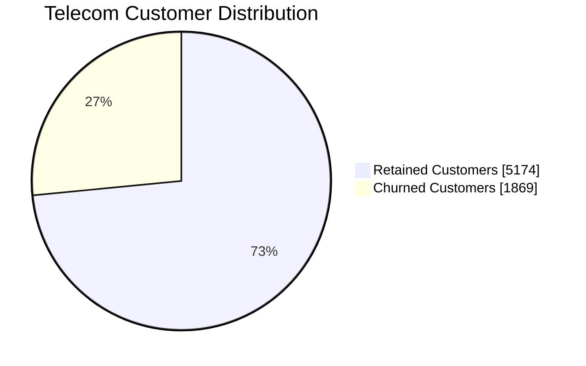
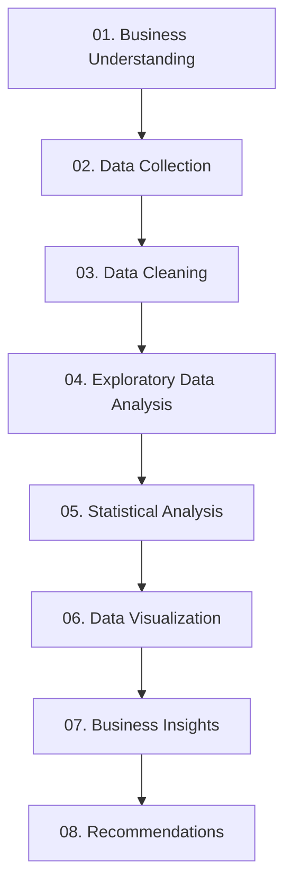

# SOMMAY DEWAT
### Data Analyst | Business Intelligence | Data Visualization

  <b>Turning Raw Data into Meaningful Insights & Business Decisions</b>
   
  📍 India &nbsp; | &nbsp; 📊 Data Analytics &nbsp; | &nbsp; 🐍 Python &nbsp; | &nbsp; 🗄️ SQL

  <a href="https://www.linkedin.com/in/sommay-dewat/">LinkedIn</a> •
  <a href="https://github.com/SommayDewat">GitHub</a>

---

## 👨‍💻 Professional Profile

I am a **BBA graduate specializing in Data Analytics, Business Intelligence, and Python-based analytical solutions.**

I enjoy transforming complex datasets into clear business insights through data cleaning, exploratory analysis, statistical methods, SQL querying, and visualization.

My approach combines business understanding with analytical thinking to identify trends, measure performance, and support data-driven decisions.

**Areas of Expertise**
- Exploratory Data Analysis (EDA)
- Data Cleaning & Transformation
- SQL & Database Management
- Business Intelligence & Reporting
- Statistical Analysis
- Customer & Retail Analytics
- Data Visualization
- Predictive Analytics

---

## ⚙️ Technical Skills

*Self-assessed visual indicators of current hands-on familiarity. These are not formal proficiency scores.*

### Programming & Data Manipulation

| Technology | Skill Level |
|:---|:---|
| Python | `█████` Core |
| Pandas | `█████` Core |
| NumPy | `████` Applied |
| SQL | `████` Applied |

### Business Intelligence & Visualization

| Technology | Skill Level |
|:---|:---|
| Power BI | `████` Applied |
| Microsoft Excel | `████` Applied |
| Matplotlib | `████` Applied |
| Seaborn | `████` Applied |
| Plotly | `███` Developing |

### Analytics & Artificial Intelligence

| Technology | Skill Level |
|:---|:---|
| Exploratory Data Analysis | `█████` Core |
| Statistical Analysis | `████` Applied |
| Machine Learning | `███` Developing |
| Natural Language Processing | `███` Developing |
| Deep Learning | `███` Developing |

### Development Tools

`MySQL` · `SQLite` · `Jupyter Notebook` · `VS Code` · `Git` · `GitHub` · `Streamlit`

---

## 📊 Data Analytics Dashboard

| ANALYTICS METRIC | DATA HANDLED |
|:---:|:---:|
| 🛒 Retail Transactions | **541K+** |
| 👥 Telecom Customers | **7,043** |
| 📈 Segmented Customers | **4,338** |
| 💬 Customer Reviews | **5,000+** |

### 📉 Customer Churn Distribution

Based on my telecom customer analysis.

### Business Performance Indicators

| KPI | Result |
|:---|---:|
| Total Customers | 7,043 |
| Retained Customers | 5,174 |
| Churned Customers | 1,869 |
| Retention Rate | 73.46% |
| Churn Rate | 26.54% |
| Average Monthly Charges | 64.76 |
| Average Tenure | 32.37 months |

### 🔎 Customer Analytics Insight

The telecom dataset shows that approximately **1 in 4 customers churned**. This makes customer retention an important area for further analysis.

---

## 📊 My Analytical Approach

### Analytics Lifecycle

| Stage | Activities | Tools |
|:---|:---|:---|
| Data Collection | Data sourcing, importing | Python, SQL |
| Data Preparation | Cleaning, validation | Pandas, NumPy |
| Analysis | EDA, statistics | Python, SQL |
| Visualization | Charts, dashboards | Power BI, Matplotlib |
| Communication | Reports, insights | Excel, Power BI |

---

## 🎓 Education & Certifications

**Bachelor of Business Administration (BBA)**  
Maharishi Dayanand University, Rohtak

**Artificial Intelligence Programming Assistant (AIPA)**  
Training in collaboration with Microsoft India

**EF SET English Certificate**  
C2 Proficient

---

## 🎯 Current Learning Focus

| Learning Area | Objective |
|:---|:---|
| Advanced SQL | Complex queries, CTEs, window functions |
| Power BI | DAX, data modeling, dashboard design |
| Advanced Excel | PivotTables, lookup functions, reporting |
| Statistics | Hypothesis testing, interpretation |
| Python | Advanced analytical techniques |
| Business Intelligence | KPI development and data storytelling |

---

## 🤝 Professional Interests

- Data Analyst
- Business Intelligence Analyst
- Data Analytics Intern
- Reporting & Visualization
- Business Analytics

---

### CONNECT • ANALYZE • INNOVATE

**Let's turn data into decisions.**

[LinkedIn](https://www.linkedin.com/in/sommay-dewat/) · [GitHub](https://github.com/SommayDewat)

